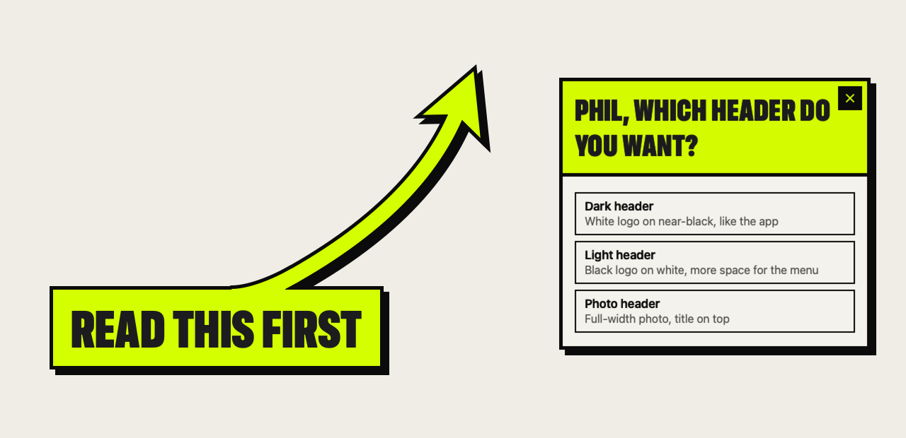
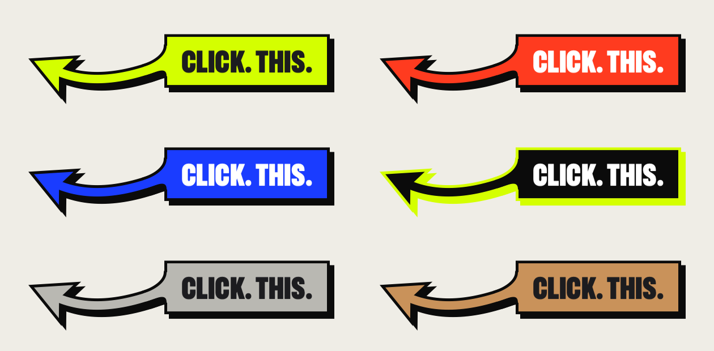
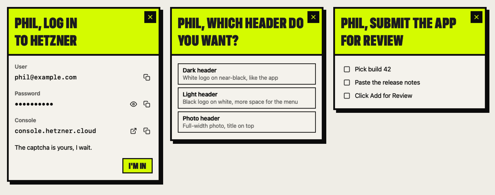

# CLICK. THIS.

**Your agent points. Now it points loud.** click-this lets an AI agent draw big streetwear arrows, signs and cue cards on top of every window on your Mac, so you never hunt for the button it means. One Swift binary, `bigarrow`. Clicks go through, your focus stays put, and every arrow removes itself. MIT licensed.



```bash
bigarrow point --mouse --look drop --sound --text "Click. This."
```

New app, new console, new settings page: finding the thing is half the battle. Your agent already knows where it is. click-this lets it point.

## The look

- **Signs:** compressed black caps, square corners, a thick ink edge, one hard shadow with no blur.
- **Arrows:** square ends, miter joins, the same hard shadow. The sign slams in with a twist, the head stamps down, the screen kicks once and an ink splat bursts at the target.
- **Cue cards:** paper, an ink frame, flush-left caps, square buttons, a hard shadow.
- **`--sound`:** a short hit as the arrow lands. Synthesized in memory, no sound file.

`--look drop` turns it on. `--look classic` gives you the rounded original style.

### Six colorways

`--color acid|flare|cobalt|ink|cement|gum`. Acid is the default.



## The three commands an agent needs

```bash
bigarrow point --element "Allow" --app "System Settings" --look drop --text "Click Allow"   # by label
bigarrow point --at 760,500 --look drop --text "Click. This."                              # by coordinate
bigarrow start --window "Safari:Inbox" --look drop --text "This window" && bigarrow stop    # until stopped
```

Every arrow ends by itself: a time limit (`--duration`, 8 s for `point`, 300 s for `start`), `bigarrow stop`, or the agent process exiting. Targets: `--at X,Y`, `--rect X,Y,W,H`, `--mouse`, `--window App[:title]`, `--element Label --app App`. Shapes: `--shape bend|straight|zigzag|spiral`. Styles: `--style arrow|ring|box`. Sizes: `--size S|M|L`. `{{value}}` in `--text` becomes a copy button.

Drawing needs no macOS permission. Only `--element`, `elements`, `--until-click` and raising a window need Accessibility. Every command takes `--json`. Exit codes: 0 ok, 1 a card ended without an answer, 2 bad input, 3 target not found, 4 permission missing.

## Cue cards

When you need more than one value, a secret or an answer, the agent holds up a card: copy buttons, an X, nothing that steals your focus. `bigarrow wait` tells the agent what you did.



```bash
bigarrow card --look drop --title "Log in to the console" --field "User=you@example.com" \
  --secret "Password=keychain:console/you" --button "done=I'm in"
bigarrow wait   # {"result":"button","value":"done","copied":["User","Password"],...}
```

Secrets come from `pass:`, `keychain:`, `op:`, `env:` or `file:`, never the command line. They show as dots, copy as concealed and leave the clipboard after 30 s. Cards also take questions (`--ask`), choices (`--choice`), checklists, live 2FA codes and more; see the [use cases](docs/cards/).

## Install

```bash
git clone https://github.com/philm123/click-this.git && cd click-this
swift build -c release && ln -sf "$PWD/.build/release/bigarrow" /opt/homebrew/bin/bigarrow
bigarrow install-skill          # teaches Claude Code and Codex
```

Needs macOS 14+ and Swift 6 (the Command Line Tools are enough). `bigarrow doctor` checks permissions and displays.

`scripts/drop-renders.sh .build/release/bigarrow /tmp/drop` renders every colorway, shape, style and three cards offscreen, without drawing on your screen.

## License

MIT. See [LICENSE](LICENSE).
